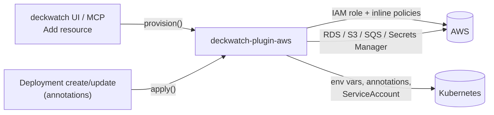

# deckwatch-plugin-aws

A [deckwatch](https://github.com/alexconrey/deckwatch) plugin that provisions AWS
infrastructure for Kubernetes applications and wires it to them with **one IAM
role and one ServiceAccount per application** (IRSA). It runs as a WASM module
inside deckwatch, calls AWS APIs directly, and works in both commercial AWS and
**AWS GovCloud (US)**.

| AWS service | What the plugin does |
|---|---|
| **IAM** | Creates the application's workload role with a trust policy scoped to its ServiceAccount, and attaches one inline policy per resource |
| **RDS** (PostgreSQL, MySQL) | Creates an encrypted, private instance with IAM database auth and 14 days of automated backups, and creates the IAM database user |
| **S3** | Creates a bucket (public access blocked by default) and grants the workload object read/write |
| **SQS** | Creates a standard or FIFO queue and grants the workload send/receive |
| **Secrets Manager** | Creates an empty secret the workload can read and write (`SM_SECRET_ARN`), or grants read access to existing secrets |
| **ECR** | Grants image pull permissions |
| **AWS Backup** | Schedules extra RDS snapshots on a cron (optional) |

Removing a resource never destroys data without a way to get it back. RDS always
takes a final snapshot, S3 buckets are kept, SQS queues with messages are kept, and
secrets keep a 30-day recovery window. Only that resource's IAM access is revoked,
and the workload role is deleted once nothing is left on it.

Every resource is tagged with `deckwatch.io/managed-by`, `deckwatch.io/application`
and `deckwatch.io/namespace`, plus any tags you set in `RESOURCE_TAGS`. SQS queues
and secrets are named with `RESOURCE_NAME_PREFIX`, so the plugin's own IAM policy
can be scoped to the queues and secrets it created.

Connection details reach the application as environment variables (`DB_HOST`,
`S3_BUCKET`, `QUEUE_URL`, …), and the pods run as the application's ServiceAccount,
so the AWS SDK picks up credentials automatically. No static keys are stored in
the workload.

## How it works

The plugin has two entry points, and both feed the same per-application identity:

- **Provisioning (recommended):** an operator adds a resource (for example "S3 Bucket")
  to a deckwatch Application. deckwatch calls `provision()` once, stores the result,
  and injects its environment variables into every deployment in the application.
- **Annotations:** `apply()` runs on every deployment create and update, and reads
  `*.deckwatch.io/*` annotations. Provisioning stamps these annotations too, so every
  reconcile keeps the resources and IAM policies in place.

## Quick start

1. **Build or download the plugin:** `make build` produces `dist/plugin.wasm`, or
   take `plugin.wasm` from a [GitHub release](https://github.com/alexconrey/deckwatch-plugin-aws/releases).
2. **Register it in deckwatch**, configure `AWS_REGION`, `OIDC_PROVIDER_ARN` and
   `RESOURCE_NAME_PREFIX` (and optionally `RESOURCE_TAGS`), and give the plugin AWS
   credentials (IRSA recommended). Set the prefix before you create the first queue
   or secret. See [Configuration](docs/configuration.md).
3. **Grant the plugin's own IAM role** the permissions in
   [Configuration → Plugin IAM permissions](docs/configuration.md#plugin-iam-permissions).
   The tagging permissions are required: every create call carries tags.
4. **Add a resource** to an application, for example **S3 Bucket** with
   `bucket_name: my-app-artifacts`. The application's pods then get `S3_BUCKET` and
   `S3_REGION` and run as `<app>-aws-sa`, whose IAM role can read and write the bucket.

## Documentation

| Page | Read it when you want to… |
|---|---|
| [Configuration](docs/configuration.md) | install the plugin, set credentials, allowed hosts and config keys, and grant the plugin's IAM permissions |
| [Resources and annotations](docs/resources.md) | know what each resource creates, which env vars it injects, and the full annotation reference |
| [Identity and IAM](docs/identity.md) | understand the workload role, ServiceAccount, trust policy, inline policies, GovCloud partitions and RDS IAM auth |
| [Operations](docs/operations.md) | upgrade the plugin, verify which binary is loaded, refresh or remove resources, and troubleshoot |
| [Development](docs/development.md) | build, test (unit, known-answer and moto integration tests), and release |
| [Integration tests](integration/README.md) | run or extend the end-to-end tests against moto, and know what they can't check |
| [CHANGELOG](CHANGELOG.md) | see what changed between versions |

## Requirements

- deckwatch with plugin support. Verifying an uploaded binary's checksum needs a
  deckwatch build that includes [alexconrey/deckwatch#206](https://github.com/alexconrey/deckwatch/pull/206).
- An EKS cluster with an IAM OIDC provider, for IRSA.
- Rust stable with the `wasm32-unknown-unknown` target, to build from source.

**Upgrading from 0.7.x?** Read the 0.8.0 *Upgrade notes* in the
[CHANGELOG](CHANGELOG.md) first. The plugin needs new IAM permissions, and
`RESOURCE_NAME_PREFIX` affects existing queues and secrets.

## License

Apache-2.0
